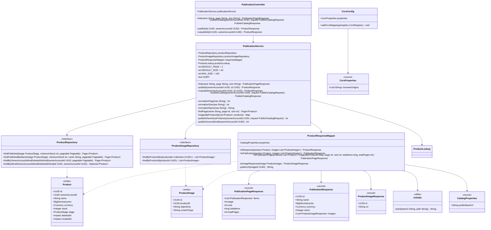
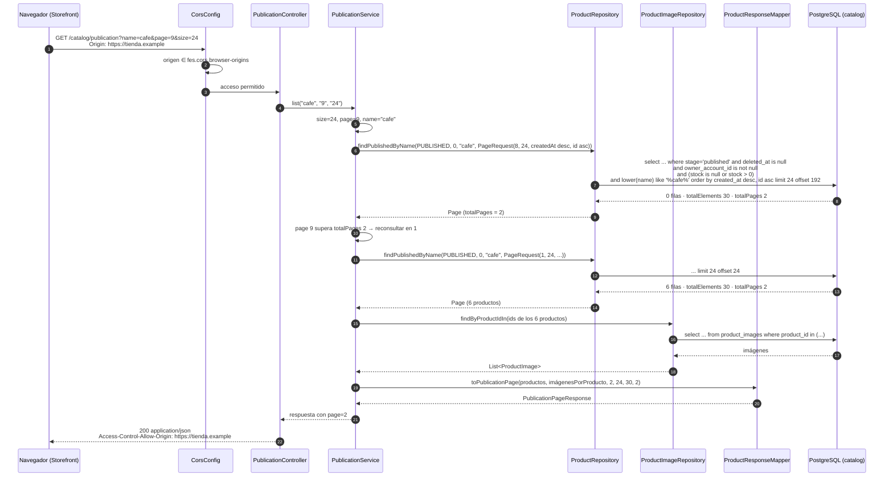
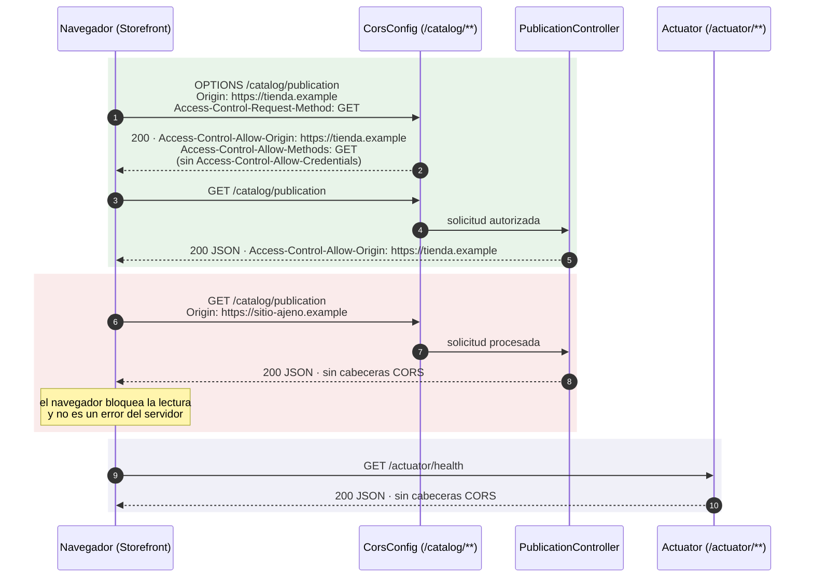
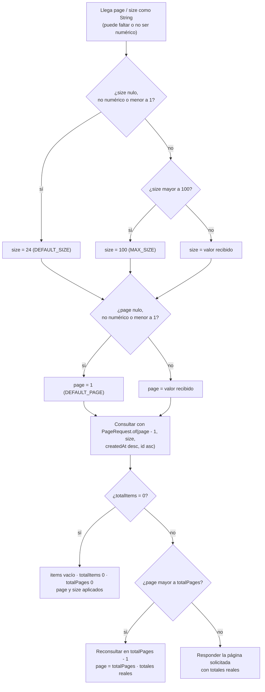

# UML 002 — Lectura pública paginada de productos publicados

Diagramas del desarrollo descrito en `spec.md`, `plan.md` y `tasks.md` de este
directorio, alineados con las convenciones de `catalog-api` (`AGENTS.md`: Java 25 /
Spring Boot 4.1, paquete `com.friendlyeshop.catalog`, arquitectura **Layered** con
extensiones `mapper`, `util` y `client/storage`). Prosa en español; diagramas en
Mermaid con los nombres previstos de clases, rutas y variables. Los controladores
dependen solo de servicios y nunca importan `repository/` ni `client/`.

## 1. Contexto

`catalog-api` es la fuente de verdad de productos, precios, stock e imágenes. Hasta
la spec 001 solo ofrecía lecturas acotadas al dueño para el panel. Este corte agrega
una lectura pública de solo lectura, `GET /catalog/publication`, que el
navegador del Storefront (`fes-client-web`) consume sin sesión ni credenciales. La
respuesta se limita a productos `published`, no borrados, con dueño y con
`stock` no informado o mayor a 0, de todos los vendedores, con filtro opcional por nombre y paginación de
24 por defecto. El acceso desde el navegador se habilita con CORS restringido a
`/catalog/**` y a los orígenes de la variable `BROWSER_ORIGINS`. El contrato del
panel y los endpoints de Actuator no cambian.

## 2. Diagrama de componentes

```mermaid
flowchart TB
  subgraph storefront [fes-client-web]
    Browser["Navegador del visitante<br/>Origin: valor de BROWSER_ORIGINS"]
  end

  subgraph catalogApi [catalog-api · com.friendlyeshop.catalog]
    subgraph configPkg [config]
      CorsProps["CorsProperties<br/>fes.cors.browser-origins<br/>(BROWSER_ORIGINS)"]
      CorsCfg["CorsConfig<br/>WebMvcConfigurer<br/>/catalog/** · GET · sin credenciales"]
      CatalogProps[CatalogProperties<br/>fes.catalog.public-base-url]
      Actuator["Actuator<br/>/actuator/health · info · prometheus<br/>(sin CORS)"]
    end

    subgraph controllers [controller]
      PubCtrl["PublicationController<br/>/publication: lectura y publicación"]
      PanelCtrl["ProductController<br/>GET /catalog/products?ownerAccountId=<br/>(sin cambios)"]
    end

    subgraph services [service]
      PubSvc["PublicationService<br/>list / publish / unpublish / publishCatalog"]
      PanelSvc["ProductService<br/>(sin cambios)"]
    end

    subgraph repos [repository]
      ProdRepo["ProductRepository<br/>+ findPublished<br/>+ findPublishedByName"]
      ImgRepo["ProductImageRepository<br/>+ findByProductIdIn"]
    end

    subgraph modelPkg [model]
      Product[Product<br/>@Entity]
      ProductImage[ProductImage<br/>@Entity]
      PageDto["PublicationPageResponse<br/>model/dto"]
      ItemDto["PublicationResponse<br/>model/dto"]
      ImgDto["ProductImageResponse<br/>model/dto"]
    end

    Mapper["ProductResponseMapper<br/>+ toPublication<br/>+ toPublicationPage"]
    Url["UrlUtils.join(baseUrl, path)"]
    Errors["GlobalExceptionHandler<br/>(sin cambios)"]
  end

  subgraph data [Infraestructura]
    DB[(PostgreSQL<br/>base catalog · tabla products)]
    Minio[(MinIO / S3<br/>imágenes)]
  end

  Browser -->|"GET /catalog/publication?name=&page=&size="| CorsCfg
  CorsCfg --> PubCtrl
  PanelCtrl --> PanelSvc
  PubCtrl --> PubSvc
  PubSvc --> ProdRepo
  PubSvc --> ImgRepo
  PubSvc --> Mapper
  ProdRepo --> Product
  ImgRepo --> ProductImage
  ProdRepo --> DB
  ImgRepo --> DB
  Mapper --> ItemDto
  Mapper --> ImgDto
  Mapper --> Url
  Mapper --> CatalogProps
  Mapper --> PageDto
  CorsCfg --> CorsProps
  Browser -.->|"GET /catalog/images/{imageId} (URL en images[].url)"| Minio
```

Notas:

- `CorsConfig` es el único punto que habilita el navegador; el mapping cubre solo
  `/catalog/**`, por lo que `/actuator/**` y el resto de las rutas quedan fuera.
- `PublicationService` es el único dueño de los casos de publicación: la lectura
  pública (`list`), la publicación/despublicación de un producto y la publicación
  del catálogo. No toca imágenes binarias ni MinIO: solo arma URLs públicas con
  `ProductResponseMapper` + `UrlUtils`.
- El panel conserva su camino (`ProductController` → `ProductService`) sin
  modificaciones.

Variables de entorno relevantes de este corte: `BROWSER_ORIGINS` (orígenes CORS) y,
heredada de la spec 001, `PUBLIC_API_BASE_URL` (base de `images[].url`). El valor de
`BROWSER_ORIGINS` por entorno pertenece a `fes-infra`.

## 3. Diagrama de clases (Layered)

Se muestran relaciones arquitectónicas y contratos de frontera; no se reproduce cada
import ni variable local.



Contrato JSON de la lectura pública:

```json
{
  "items": [
    {
      "id": "uuid",
      "name": "Café molido 500 g",
      "price": 1234.5,
      "currency": "ARS",
      "stock": 7,
      "images": [{ "id": "uuid", "url": "https://host/catalog/images/uuid" }]
    }
  ],
  "page": 1,
  "size": 24,
  "totalItems": 57,
  "totalPages": 3
}
```

## 4. Secuencia — lectura pública con filtro y página fuera de rango

Flujo principal: el Storefront pide la página 9 de un catálogo que solo tiene 2
páginas; el servicio la ajusta a la última disponible y devuelve los totales reales.



Casos cubiertos por el mismo flujo:

- `name` ausente o en blanco → `findPublished` en lugar de `findPublishedByName`.
- `totalItems` 0 → `items` vacío, `totalItems` 0, `totalPages` 0, sin reconsultar.
- `size` 150 → se aplica 100; `page` `abc` o `0` → se aplica 1.
- Producto publicado sin dueño, borrado, en borrador o con stock cero/negativo nunca
  aparece: queda filtrado en la consulta SQL. El stock no informado sí se muestra.

## 5. Secuencia — verificación previa CORS y origen no permitido



Con `BROWSER_ORIGINS` vacía o ausente, `CorsProperties.browserOrigins` queda en lista
vacía, el mapping no autoriza ningún origen y el servicio arranca sin fallar; las
respuestas de datos son idénticas pero sin cabeceras CORS.

## 6. Flujo — normalización de `page` y `size`



El parseo usa `String` en el controlador justamente para que un valor no numérico no
produzca 400, y `NumberFormatException` se captura solo en la conversión, sin ocultar
otros errores.
