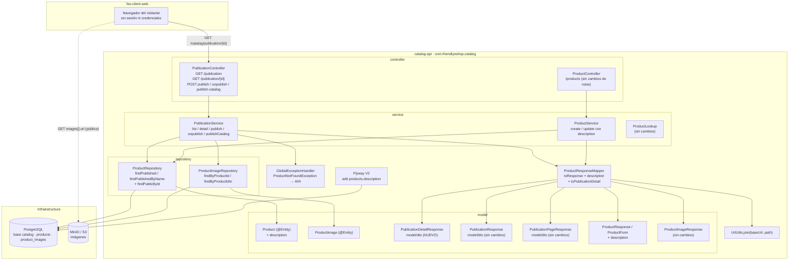
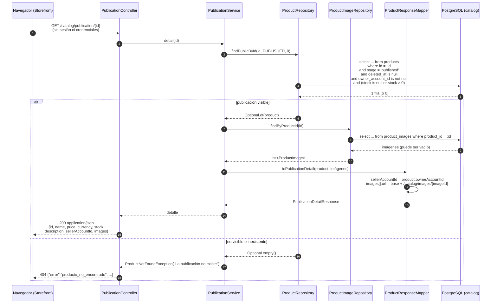
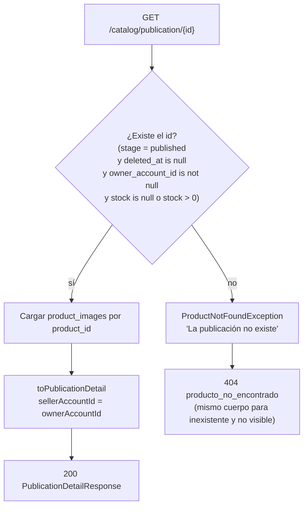
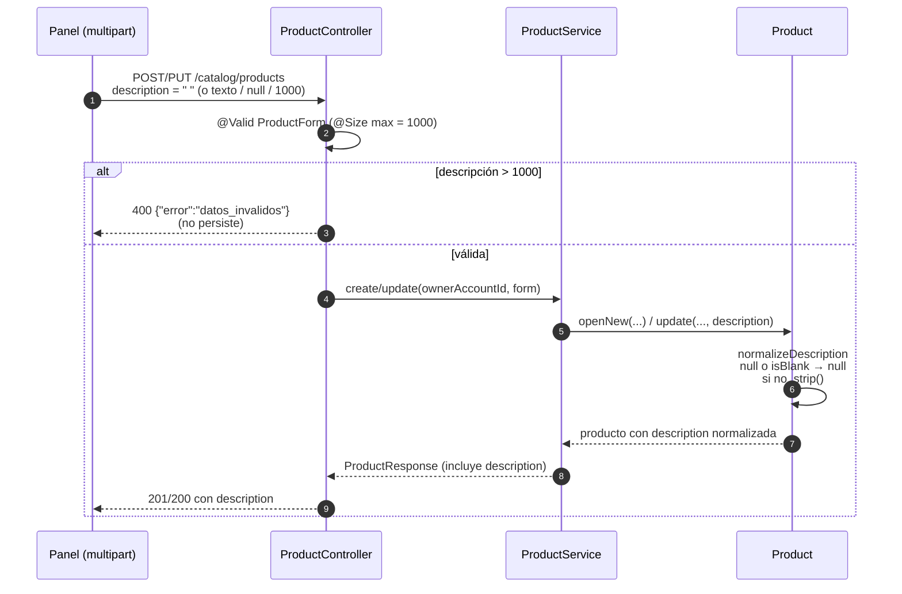

# UML 003 — Detalle público de publicación con descripción y referencia al vendedor

Diagramas del desarrollo descrito en `spec.md`, `plan.md` y `tasks.md` de este
directorio, alineados con las convenciones de `catalog-api` (`AGENTS.md`: Java 25 /
Spring Boot 4.1, paquete `com.friendlyeshop.catalog`, arquitectura **Layered** con
extensiones `mapper`, `util` y `client/storage`). Prosa en español; los diagramas
Mermaid conservan los nombres reales de clases, rutas, columnas y variables. Los
controladores dependen solo de servicios y nunca importan `repository/`.

## 1. Contexto

`catalog-api` es la fuente de verdad de productos, precios, stock, imágenes y —desde
este corte— descripción. La spec 002 expuso la grilla pública paginada
`GET /catalog/publication`, pero no permitía abrir una publicación concreta. Este
corte agrega:

- una **descripción opcional** por producto (`VARCHAR(1000) NULL`) que se normaliza a
  ausente cuando llega vacía o solo con espacios y que se conserva al publicar y
  despublicar;
- un **detalle público de solo lectura** `GET /catalog/publication/{id}` que devuelve
  nombre, precio, moneda, stock, descripción, imágenes con su URL pública y el
  `sellerAccountId` como referencia pública al vendedor;
- la misma noción de **visibilidad** de la grilla: `published`, no borrado, con dueño
  y con stock no informado o mayor a 0.

La grilla paginada y su `PublicationResponse` no cambian. El panel conserva sus rutas
y operaciones; su `ProductResponse` solo suma `description` de forma aditiva.
Actuator, health checks y métricas quedan fuera del cambio.

## 2. Diagrama de estructura (componentes)



Notas:

- `PublicationController` agrupa el detalle junto al listado y las operaciones de
  publicación; el prefijo `/catalog` lo aporta `ApiPathConfig`.
- `PublicationService.detail` es de solo lectura y no modifica estado.
- El panel conserva su camino `ProductController → ProductService`, que ahora
  propaga `description` en alta y edición.
- La grilla sigue mapeando con `toPublication`/`toPublicationPage` sin descripción.

## 3. Diagrama de clases (entidad, DTOs, mapper, servicio, controller)

Se muestran relaciones arquitectónicas y contratos de frontera; no se reproduce cada
import ni variable local.

```mermaid
classDiagram
  direction TB

  class PublicationController {
    -PublicationService publicationService
    +list(name String, page String, size String) PublicationPageResponse
    +detail(id UUID) PublicationDetailResponse
    +publish(id UUID, ownerAccountId UUID) ProductResponse
    +unpublish(id UUID, ownerAccountId UUID) ProductResponse
    +publishCatalog(ownerAccountId UUID, request PublishCatalogRequest) PublishCatalogResponse
  }

  class PublicationService {
    -ProductRepository productRepository
    -ProductImageRepository productImageRepository
    -ProductResponseMapper responseMapper
    -ProductLookup productLookup
    -int MINIMUM_STOCK = 0
    +list(name String, page String, size String) PublicationPageResponse
    +detail(id UUID) PublicationDetailResponse
    +publish(ownerAccountId UUID, id UUID) ProductResponse
    +unpublish(ownerAccountId UUID, id UUID) ProductResponse
    +publishCatalog(ownerAccountId UUID, request PublishCatalogRequest) PublishCatalogResponse
  }

  class ProductService {
    -ProductRepository productRepository
    -ProductResponseMapper responseMapper
    +create(ownerAccountId UUID, form ProductForm) ProductResponse
    +update(ownerAccountId UUID, id UUID, form ProductForm) ProductResponse
  }

  class ProductRepository {
    <<interface>>
    +findPublicById(id UUID, stage ProductStage, minimumStock int) Optional~Product~
    +findPublished(stage ProductStage, minimumStock int, pageable Pageable) Page~Product~
    +findByOwnerAccountIdAndDeletedAtIsNull(ownerAccountId UUID, pageable Pageable) Page~Product~
    +findByIdAndOwnerAccountIdAndDeletedAtIsNull(id UUID, ownerAccountId UUID) Optional~Product~
  }

  class ProductImageRepository {
    <<interface>>
    +findByProductId(productId UUID) List~ProductImage~
    +findByProductIdIn(productIds Collection~UUID~) List~ProductImage~
  }

  class ProductResponseMapper {
    -CatalogProperties properties
    +toResponse(product Product, images List~ProductImage~) ProductResponse
    +toPublication(product Product, images List~ProductImage~) PublicationResponse
    +toPublicationPage(products List~Product~, imagesByProductId Map, page int, size int, totalItems long, totalPages int) PublicationPageResponse
    +toPublicationDetail(product Product, images List~ProductImage~) PublicationDetailResponse
    -toImageResponses(images List~ProductImage~) List~ProductImageResponse~
    -publicUrl(imageId UUID) String
  }

  class Product {
    <<entity>>
    +UUID id
    +UUID ownerAccountId
    +String name
    +BigDecimal price
    +Currency currency
    +Integer stock
    +String description
    +ProductStage stage
    +Instant deletedAt
    +openNew(ownerAccountId UUID, name String, price BigDecimal, currency Currency, stock Integer, description String)$ Product
    +update(name String, price BigDecimal, currency Currency, stock Integer, description String) void
    +publish() void
    +unpublish() void
    -normalizeDescription(description String)$ String
  }

  class PublicationDetailResponse {
    <<record>>
    +UUID id
    +String name
    +BigDecimal price
    +Currency currency
    +Integer stock
    +String description
    +UUID sellerAccountId
    +List~ProductImageResponse~ images
  }

  class ProductResponse {
    <<record>>
    +UUID id
    +UUID ownerAccountId
    +String name
    +String description
    +BigDecimal price
    +Currency currency
    +Integer stock
    +ProductStage stage
    +List~ProductImageResponse~ images
  }

  class ProductForm {
    <<record>>
    +String name
    +String description
    +BigDecimal price
    +Currency currency
    +Integer stock
    +List~MultipartFile~ images
  }

  class PublicationResponse {
    <<record>>
    +UUID id
    +String name
    +BigDecimal price
    +Currency currency
    +Integer stock
    +List~ProductImageResponse~ images
  }

  class ProductImage {
    <<entity>>
    +UUID id
    +UUID productId
    +String objectKey
    +String contentType
  }

  class ProductImageResponse {
    <<record>>
    +UUID id
    +String url
  }

  class ProductNotFoundException {
    <<exception>>
  }

  PublicationController --> PublicationService
  PublicationController ..> PublicationDetailResponse
  PublicationService --> ProductRepository
  PublicationService --> ProductImageRepository
  PublicationService --> ProductResponseMapper
  PublicationService ..> ProductNotFoundException
  ProductService --> ProductRepository
  ProductService --> ProductResponseMapper
  ProductResponseMapper --> PublicationDetailResponse
  ProductResponseMapper --> PublicationResponse
  ProductResponseMapper --> ProductResponse
  ProductResponseMapper --> ProductImageResponse
  ProductRepository ..> Product
  ProductImageRepository ..> ProductImage
  ProductResponseMapper ..> Product
  ProductResponseMapper ..> ProductImage
  ProductService ..> ProductForm
```



Relaciones clave:

- `PublicationController` solo conoce `PublicationService` y el DTO de salida; nunca
  toca el repositorio ni la entidad.
- `PublicationService.detail` usa `ProductRepository.findPublicById`, que aplica las
  cuatro condiciones de visibilidad, y `ProductImageRepository.findByProductId`.
- `ProductResponseMapper` es el único punto que arma `PublicationDetailResponse` y la
  URL pública de imagen; por eso `sellerAccountId` y `images[].url` salen de un solo
  lugar.
- `Product` es dueña de la normalización de la descripción; `ProductForm` y
  `ProductResponse` solo transportan el valor.

## 4. Contrato JSON del detalle

```json
{
  "id": "8f3c2b1a-0000-4000-8000-000000000000",
  "name": "Café molido 500 g",
  "price": 1234.5,
  "currency": "ARS",
  "stock": 7,
  "description": "Café de tueste medio, molido para filtro.",
  "sellerAccountId": "1a2b3c4d-0000-4000-8000-000000000000",
  "images": [{ "id": "uuid", "url": "https://host/catalog/images/uuid" }]
}
```

- `description` puede ser `null` (se serializa como nula, sin texto por defecto).
- `images` es `[]` cuando no hay imágenes.
- No aparecen `stage`, `ownerAccountId`, email, credenciales ni fechas.

## 5. Secuencia — detalle público de una publicación visible

Flujo principal: el visitante abre el detalle de una publicación visible; el sistema
la busca con las condiciones de visibilidad, carga sus imágenes y responde el DTO
público.



Casos cubiertos por el mismo flujo:

- `stock = null` → visible; `stock = 0` o negativo → 404.
- Borrador, despublicado, borrado lógico o sin dueño → 404 idéntico al inexistente.
- Sin imágenes → `images: []`.
- Sin descripción → `description: null`, sin texto por defecto.
- `description` con acentos se devuelve tal como se almacenó.

## 6. Flujo — visibilidad del detalle



La consulta `findPublicById` es la única fuente de la decisión de visibilidad; el
servicio no reimplementa esas condiciones ni consulta tablas de otros dominios.

## 7. Secuencia — normalización de descripción en alta/edición del panel



La validación de longitud vive en `ProductForm`; la entidad solo normaliza vacío o
solo espacios a `null` y conserva el contenido válido.
