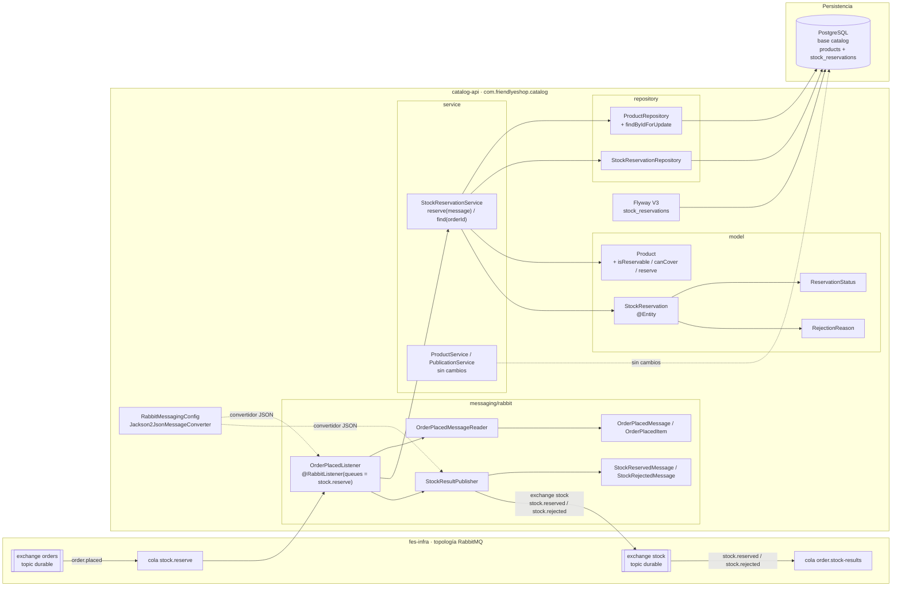
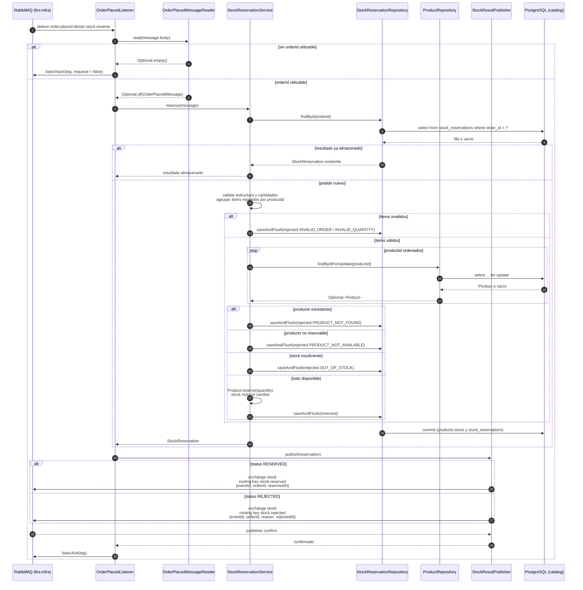
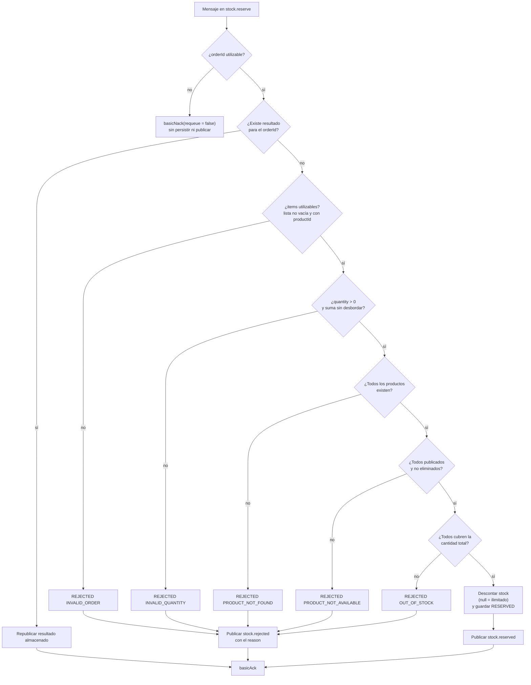

# UML 004 — Reserva de stock desde `order.placed` con resultado y compensación

Diagramas del desarrollo descrito en `spec.md`, `plan.md` y `tasks.md` de este
directorio, alineados con las convenciones de `catalog-api` (`AGENTS.md`: Java 25 /
Spring Boot 4.1, paquete `com.friendlyeshop.catalog`, arquitectura **Layered** con la
extensión `messaging/rabbit/`). Prosa en español; los diagramas Mermaid conservan los
nombres reales de clases, rutas, colas, exchanges, variables y payloads. No se declara
topología RabbitMQ: `fes-infra` es dueño de `orders`, `stock.reserve`, `stock` y
`order.stock-results`; este servicio solo consume y publica por nombre.

## 1. Contexto

`catalog-api` es la fuente de verdad de productos y stock. En este corte incorpora el
consumidor de la cola `stock.reserve` (exchange `orders`, routing key `order.placed`),
la reserva de stock idempotente por `orderId`, el registro del resultado y la publicación
de `stock.reserved` o `stock.rejected` en el exchange `stock`. El `eventId` se guarda
para trazabilidad y se reutiliza al republicar el resultado almacenado; la idempotencia
se ancla al `orderId`.

Reglas centrales:

- stock nulo = ilimitado; la reserva se confirma sin descontar;
- solo productos publicados y no eliminados son reservables;
- ítems repetidos del mismo producto se suman antes de comprobar disponibilidad;
- todo o nada: no hay reservas parciales, sobreventa ni stock negativo;
- ACK solo después de persistir el resultado y publicarlo; una falla deja el mensaje sin
  confirmar para que `fes-infra` decida retry o DLQ;
- un evento sin `orderId` utilizable no se persiste, no se publica y se hace NACK sin
  reencolar.

## 2. Diagrama de estructura (componentes)



Notas:

- `/catalog`, `ProductService`, `PublicationService`, Actuator y health checks no
  participan del flujo de reserva y quedan sin cambios.
- No hay beans `Queue`, `Exchange`, `Binding`, TTL ni DLX en `catalog-api`.
- `RABBITMQ_HOST`, `RABBITMQ_PORT`, `RABBITMQ_USERNAME`, `RABBITMQ_PASSWORD` y
  `RABBITMQ_VIRTUAL_HOST` se reutilizan desde `application.yaml`.

## 3. Diagrama de clases (frontera de mensajería, servicio y persistencia)

Se muestran relaciones arquitectónicas y contratos de frontera; no se reproduce cada
import ni variable local.

```mermaid
classDiagram
  direction TB

  class OrderPlacedListener {
    -OrderPlacedMessageReader reader
    -StockReservationService reservationService
    -StockResultPublisher publisher
    +onOrderPlaced(message Message, channel Channel) void
  }

  class OrderPlacedMessageReader {
    -ObjectMapper objectMapper
    +read(body byte[]) Optional~OrderPlacedMessage~
  }

  class OrderPlacedMessage {
    <<record>>
    +UUID eventId
    +UUID orderId
    +List~OrderPlacedItem~ items
  }

  class OrderPlacedItem {
    <<record>>
    +UUID productId
    +Integer quantity
  }

  class StockReservationService {
    -ProductRepository productRepository
    -StockReservationRepository reservationRepository
    +reserve(message OrderPlacedMessage) StockReservation
    +find(orderId UUID) Optional~StockReservation~
    -reject(eventId UUID, orderId UUID, reason RejectionReason) StockReservation
  }

  class StockResultPublisher {
    -RabbitTemplate rabbitTemplate
    +publish(reservation StockReservation) void
  }

  class StockReservedMessage {
    <<record>>
    +UUID eventId
    +UUID orderId
    +Instant reservedAt
    +from(reservation StockReservation)$ StockReservedMessage
  }

  class StockRejectedMessage {
    <<record>>
    +UUID eventId
    +UUID orderId
    +RejectionReason reason
    +Instant rejectedAt
    +from(reservation StockReservation)$ StockRejectedMessage
  }

  class ProductRepository {
    <<interface>>
    +findByIdForUpdate(id UUID) Optional~Product~
    +findPublished(stage ProductStage, minimumStock int, pageable Pageable) Page~Product~
    +findPublicById(id UUID, stage ProductStage, minimumStock int) Optional~Product~
  }

  class StockReservationRepository {
    <<interface>>
    +findById(orderId UUID) Optional~StockReservation~
    +saveAndFlush(reservation StockReservation) StockReservation
  }

  class Product {
    <<entity>>
    +UUID id
    +Integer stock
    +ProductStage stage
    +Instant deletedAt
    +isReservable() boolean
    +canCover(quantity int) boolean
    +reserve(quantity int) void
  }

  class StockReservation {
    <<entity>>
    +UUID orderId
    +UUID eventId
    +ReservationStatus status
    +RejectionReason reason
    +Instant reservedAt
    +Instant rejectedAt
    +reserved(eventId UUID, orderId UUID, now Instant)$ StockReservation
    +rejected(eventId UUID, orderId UUID, reason RejectionReason, now Instant)$ StockReservation
  }

  class ReservationStatus {
    <<enumeration>>
    RESERVED
    REJECTED
  }

  class RejectionReason {
    <<enumeration>>
    OUT_OF_STOCK
    PRODUCT_NOT_FOUND
    PRODUCT_NOT_AVAILABLE
    INVALID_QUANTITY
    INVALID_ORDER
  }

  class RabbitMessagingConfig {
    +jsonMessageConverter(objectMapper ObjectMapper) MessageConverter
  }

  OrderPlacedListener --> OrderPlacedMessageReader
  OrderPlacedListener --> StockReservationService
  OrderPlacedListener --> StockResultPublisher
  OrderPlacedMessageReader ..> OrderPlacedMessage
  OrderPlacedMessage *-- OrderPlacedItem
  StockReservationService --> ProductRepository
  StockReservationService --> StockReservationRepository
  StockReservationService ..> Product
  StockReservationService ..> StockReservation
  StockReservationService ..> RejectionReason
  StockResultPublisher ..> StockReservedMessage
  StockResultPublisher ..> StockRejectedMessage
  StockReservation --> ReservationStatus
  StockReservation --> RejectionReason
  RabbitMessagingConfig ..> StockResultPublisher
```



Relaciones clave:

- `OrderPlacedListener` solo conoce el reader, el servicio y el publisher; no toca
  repositorios ni entidades directamente.
- `StockReservationService` es el dueño del algoritmo de idempotencia, validación,
  bloqueo y resultado; `Product` concentra las reglas de stock.
- `StockResultPublisher` arma el payload desde la entidad `StockReservation`, reutilizando
  el `eventId` almacenado.
- `RabbitMessagingConfig` solo aporta el convertidor JSON; no declara topología.

## 4. Secuencia — consumo, reserva, publicación y ACK

Flujo principal para un `order.placed` con `orderId` utilizable. El `alt` cubre el
resultado almacenado y los rechazos.



Casos cubiertos por este flujo:

- Reentrega del mismo `orderId`: se salta la reserva y se republica el resultado
  almacenado.
- `eventId` distinto con el mismo `orderId`: se reutiliza el `eventId` guardado.
- Stock nulo: `Product.reserve` no modifica el valor y la reserva se confirma.
- Rechazo: se guarda la fila `REJECTED`, no se descuenta stock y se publica
  `stock.rejected`.
- Falla de BD o de publicación: no se hace ACK; el mensaje queda para retry/DLQ de
  `fes-infra`.

## 5. Flujo de decisión y motivos de rechazo



La precedencia del motivo es estructura del pedido → cantidad → existencia →
disponibilidad → stock, de modo que un pedido con varios problemas informa siempre el
mismo motivo. `INVALID_ORDER` cubre la falta de ítems, la falta de `productId` y la
ausencia de ítems válidos; `INVALID_QUANTITY` cubre cantidad nula, cero, negativa o suma
desbordada.

## 6. Contratos JSON

Entrada consumida desde `stock.reserve` (solo se usan `eventId`, `orderId` e
`items[].productId`, `items[].quantity`; el resto se ignora):

```json
{
  "eventId": "8f3c2b1a-0000-4000-8000-000000000000",
  "eventType": "order.placed",
  "occurredAt": "2026-11-25T12:00:00Z",
  "orderId": "1a2b3c4d-0000-4000-8000-000000000000",
  "tenantId": "uuid",
  "items": [
    { "productId": "uuid", "quantity": 2, "unitPrice": 10.00, "currency": "ARS" }
  ],
  "total": 20.00,
  "currency": "ARS"
}
```

Salida `stock.reserved` en el exchange `stock`:

```json
{
  "eventId": "8f3c2b1a-0000-4000-8000-000000000000",
  "orderId": "1a2b3c4d-0000-4000-8000-000000000000",
  "reservedAt": "2026-11-25T12:00:00Z"
}
```

Salida `stock.rejected` en el exchange `stock`:

```json
{
  "eventId": "8f3c2b1a-0000-4000-8000-000000000000",
  "orderId": "1a2b3c4d-0000-4000-8000-000000000000",
  "reason": "OUT_OF_STOCK",
  "rejectedAt": "2026-11-25T12:00:00Z"
}
```

- `eventId` puede ser `null` si el evento original no lo traía; se conserva el valor
  registrado al procesar el pedido.
- `reason` solo puede ser `OUT_OF_STOCK`, `PRODUCT_NOT_FOUND`, `PRODUCT_NOT_AVAILABLE`,
  `INVALID_QUANTITY` o `INVALID_ORDER`.
- No se exponen endpoints HTTP nuevos; `/catalog`, imágenes, publicación y Actuator
  quedan fuera de este flujo.
